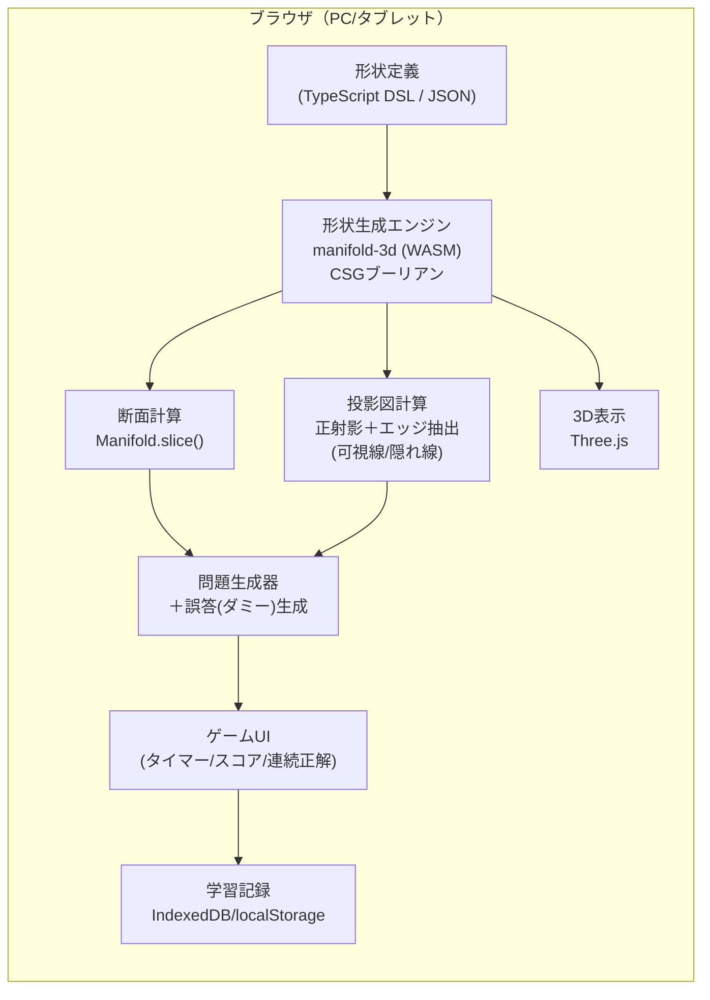

# 空間認識トレーニングアプリ 計画書（v0.2）

> 目的：3次元CADの業務で必要な **「断面形状」「矢視（投影図）」を速く正確に頭の中で作る力** を、ゲーム感覚の反復で鍛える。
> 利用者：本人のみ（機械設計者）。

---

## 1. 鍛えたい能力と出題タイプ

| # | 出題タイプ | 見せるもの | 答えるもの | 鍛える能力 | 優先度 |
|---|---|---|---|---|---|
| Q1 | **断面当て** | 3D形状＋切断面（半透明の板） | 断面形状（4択） | 断面の想像 | ★★★ MVP |
| Q2 | **矢視当て** | 3D形状＋視線の矢印（例：+X方向から） | 投影図（4択、隠れ線あり/なし） | 投影・第三角法 | ★★★ MVP |
| Q3 | **三面図→立体** | 正面図・平面図・側面図 | 該当する3D形状（4択） | 図面読解（逆変換） | ★★ |
| Q4 | **2面図→残り1面** | 2つの投影図 | 不足する1面（4択） | 図面の整合性判断 | ★★ |
| Q5 | **切断位置当て** | 3D形状＋断面形状 | どの位置/向きで切ったか | 逆方向の断面思考 | ★ |
| Q6 | **回転後の見え方** | 3D形状＋回転指示（X軸90°など） | 回転後の矢視 | メンタルローテーション | ★ |
| Q7 | **描画回答モード** | Q1/Q2と同じ | グリッド上に自分で描く→自動採点 | 再生（選択より難しい） | 将来 |

**回答後は必ず「答え合わせ表示」**：3Dモデルを実際に切断して断面を色付き表示、回転・アニメーションで確認できる（ここが学習効果の核心）。

---

## 2. 形状ライブラリ（100個以上）

形状は手でモデリングせず、**パラメトリック定義（CSGツリー＝ブーリアン演算の組合せ）** で生成する。
「ファミリー × パラメータ」で数を増やしつつ、学習的に意味のある形を選ぶ。

| カテゴリ | 例 | 想定数 | 難易度 |
|---|---|---|---|
| A. 基本立体 | 直方体、円柱、円錐、球、トーラス、角錐、多角柱 | 15 | ★ |
| B. 段付き・切欠き | L字、T字、階段、コの字、斜めカット、面取り | 20 | ★〜★★ |
| C. 穴加工 | 貫通穴、止まり穴、座ぐり、皿穴、長穴、タップ下穴 | 15 | ★★ |
| D. 機械部品風 | フランジ、ブラケット、リブ付きプレート、ボス、キー溝付き軸、軸受ハウジング | 25 | ★★〜★★★ |
| E. 回転体 | 段付き軸、プーリ、溝付き円盤、ノズル | 10 | ★★ |
| F. 相貫体 | 円柱×円柱（T字・十字・斜め）、円柱×角柱、スタインメッツ立体 | 10 | ★★★ |
| G. パズル系 | 3方向から見て異なる形（例：○△□すべてに見える立体）、斜面の組合せ | 10 | ★★★ |
| **合計** | | **約105＋パラメータ違い** | |

切断面の種類（Q1）：
- 軸平行（XY/YZ/ZX）× オフセット位置 → 基本
- 傾斜面（1軸回転）→ 中級（例：円柱の斜め切断＝楕円）
- 任意傾斜（2軸回転）→ 上級（例：立方体の正六角形断面、円錐の二次曲線）

→ 形状105 × 切断面/視点 数種類 で、**問題数は実質数千問を自動生成**できる。

---

## 3. 技術構成（案）



| 要素 | 採用案 | 理由 |
|---|---|---|
| 形態 | Webアプリ（PWA） | インストール不要、PC/タブレット両対応、オフライン可 |
| 言語/ビルド | TypeScript + Vite | 型安全、軽量 |
| 3D表示 | Three.js | 事実上の標準。正射影カメラ・切断面(clipping plane)表示が可能 |
| ブーリアン/断面 | manifold-3d（WASM） | 堅牢なCSG、断面スライス・投影機能あり（※Phase0で要検証） |
| UI | React または素のTS（軽量重視ならPreact） | |
| 保存 | IndexedDB（ブラウザ内） | 個人利用なのでサーバ不要 |
| 配布 | GitHub Pages | 無料、スマホ/PCどこでも開ける |

### 事実と推測の区別
- **事実**：Three.js は正射影カメラ（OrthographicCamera）、クリッピング平面、エッジ抽出（EdgesGeometry）を標準で備える。
- **事実**：manifold は C++ 製の CSG ライブラリで、WASM 版（npm: `manifold-3d`）が公開されている。
- **推測（要検証）**：manifold-3d の `slice()`（断面ポリゴン取得）と `project()`（投影外形取得）を使えば、正解図を厳密に自動生成できる。→ Phase 0 で動作確認。
- **推測（要検証）**：隠れ線（破線）付き投影図は、エッジ抽出＋深度判定（レイキャスト or 2パス描画）で実装可能。精度と速度は Phase 0 で確認。

---

## 4. 誤答（ダミー選択肢）の作り方 — 学習効果の鍵

ランダムな別形状では簡単すぎるので、**「ありがちな間違い」を意図的に作る**。

| 誤答パターン | 内容 | 狙い |
|---|---|---|
| 鏡像 | 左右/上下反転 | 視点の向きの取り違え |
| 位置ずれ | 切断位置を少しずらした断面 | 穴・段の位置関係の誤認 |
| 欠落 | 穴・溝を消した断面 | 内部形状の見落とし |
| 別方向 | 他の矢視（例：+Xと-Xの取り違え） | 第一角法/第三角法の混同 |
| 隠れ線誤り | 隠れ線の有無・位置の誤り | 内部形状の投影 |
| 形状近似 | 楕円⇔円、台形⇔長方形 | 傾斜断面の想像 |

---

## 5. ゲーム要素・学習設計

```
[モード選択] → [出題（制限時間）] → [回答] → [答え合わせ：3Dで切断アニメ] → [次へ]
                                                       ↓
                                              [弱点カテゴリを記録]
```

| 機能 | 内容 |
|---|---|
| モード | 練習（時間無制限・ヒントあり）／タイムアタック（10問の速さ）／サバイバル（ミスで終了）／デイリー（毎日10問） |
| スコア | 正解＋回答時間ボーナス＋連続正解コンボ |
| 難易度 | 形状難易度 × 切断面の複雑さ × 選択肢の紛らわしさ で自動調整 |
| 弱点復習 | 間違えた形状/カテゴリを優先出題（間隔反復＝忘却曲線に基づく復習） |
| 統計 | カテゴリ別正答率・平均回答時間の推移グラフ |
| ヒント | 3Dモデルを回転可能にする／切断面だけ表示 等（使用でスコア減） |

---

## 6. 開発フェーズ

| Phase | 内容 | 成果物 | 目安 |
|---|---|---|---|
| **0. 技術検証** | manifold-3d でCSG→断面→2D描画、Three.jsで3D表示、隠れ線投影の試作 | 動くプロトタイプ1画面 | 小 |
| **1. MVP** | 形状30個、Q1断面当て（軸平行）、Q2矢視当て（6方向）、4択、答え合わせ3D表示 | 遊べる最小版 | 中 |
| **2. 形状拡充** | 形状105個以上、傾斜断面、誤答パターン強化、難易度設定 | 本格版 | 中〜大 |
| **3. 学習機能** | スコア/モード/統計/弱点復習、Q3・Q4追加 | トレーニングアプリとして完成 | 中 |
| **4. 仕上げ** | PWA化（オフライン）、GitHub Pages公開、Q5・Q6追加 | 常用できる状態 | 小 |
| 5. 将来 | Q7描画回答、自作形状の追加エディタ、STEP/STL読込 | | — |

---

## 7. ディレクトリ構成（案）

```
src/
  shapes/        形状定義（カテゴリ別、1ファイル=1ファミリー）
  geometry/      manifold連携、断面・投影計算
  quiz/          問題生成、誤答生成、採点
  render/        Three.js 3D表示、2D図（SVG）描画
  ui/            画面、ゲーム進行
  storage/       学習記録
tests/           形状生成・断面計算のテスト
docs/PLAN.md     本書
```

---

## 8. 決定事項

| 項目 | 決定 |
|---|---|
| 使用端末 | スマホ中心（縦画面・タッチ操作） |
| 投影法 | 第三角法 |
| 隠れ線 | 表示する（破線） |
| 回答方式 | 4択 |
| 座標系 | Z上（正面図 = −Y 側から +Y 方向を見る） |
| 公開 | GitHub Pages |

## 9. 進捗

| Phase | 状態 | メモ |
|---|---|---|
| 0. 技術検証 | ✅ 完了 | manifold-3d の `slice()`/`project()` を確認（事実）。隠れ線は稜線＋輪郭線抽出＋BVHレイキャストで実装し、122形状×3方向を約0.45秒で計算（サーバ実測） |
| 1. MVP | ✅ 完了 | 断面当て・矢視当て・ミックス、3段階の難易度、答え合わせアニメーション |
| 2. 形状拡充 | ✅ 122形状 | 傾斜断面（1軸・2軸）、誤答5種 |
| 3. 学習機能 | ✅ 完了 | スコア・連続正解・苦手優先・成績画面・ギャラリー（三面図）。Q3 三面図→立体、Q4 不足する1面、三面図の誤り探し、減点付きヒント（切断線／透視） |
| 4. 仕上げ | ✅ 一部 | PWA（オフライン対応）、Pages 自動デプロイ設定 |

| 5. 難度拡張 | ✅ 完了 | 上級部品30形状（計152）、難易度「エキスパート」、応用3形式（回転後の図・斜め矢視・3点を通る断面） |

### 応用問題の設計
| 形式 | 正解 | 主な誤答 |
|---|---|---|
| 回転後の図 | 空間固定軸まわりの回転（右ねじ正）後の投影図。エキスパートは2回転 | 回転の向きが逆／回転軸が違う／回転の順番が逆／回転前の図／鏡像 |
| 斜め矢視 | 斜面の法線方向（補助投影）または45°方向からの投影図 | 30°・50°ずれた方向／最寄りの主投影図／反対側／鏡像／隠れ線を実線化 |
| 3点を通る断面 | 稜線上の3点（頂点・中点・1/4点）を通る平面の断面。平面は非表示 | 3点目が違う面／平行にずれた面／鏡像 |

### 三面図系の誤答の作り方
正解形状を少し変えた立体（角の切欠き・稜の面取り・中央の穴・上面の溝）を自動生成し、三面図のうち1〜2面だけが一致するものを優先。三面図がほぼ一致する立体は「別解」になりうるので除外。

### 実装中に判明したこと（事実）
- manifold-3d の `extrude()` の `scaleTop` に数値を渡すと Y 方向の倍率が 0 になる → `[s, s]` で渡す
- `trimByPlane()` の offset は「単位法線方向の距離」→ 正規化して扱う
- 曲線の隠れ線は短い線分の集まりで、そのまま SVG 化すると破線パターンが線分ごとにリセットされ実線に見える → 折れ線に連結してから描画

